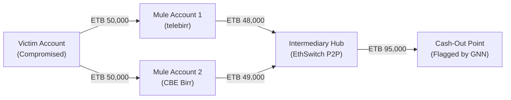

# Ethio-Cyber-Shield (ECS) — Full Platform Vision, Machine Learning & AI Roadmap (v4.0+)

> **Document Designation**: Strategic Architectural Vision & Artificial Intelligence Technical Specification  
> **Institutional Submission**: Official Research & Architecture Roadmap submitted to the **Information Network Security Administration (INSA)**, Federal Democratic Republic of Ethiopia.  
> **Project Research Consortium**:  
> • Musab Hassen Aliyi (`CTC-384-26`) — Lead System Architect & Project Coordinator  
> • Osman Mohammed Seid (`CTC-2974-26`) — Lead Detection Engine & Threat Intelligence Engineer  
> • Kedist Eyasu Embaye (`CTC-1247-26`) — Security Telemetry & Cryptographic Verification Engineer  
> • Yoseph Abebe Ersedo (`CTC-430-26`) — SOC Operations & Frontend Visualization Engineer  
> • Omer Mohammed Seid (`CTC-3716-26`) — Core Backend & Multi-Tenancy Systems Engineer  
> • Efrem Mola Genebo (`CTC-4772-26`) — Red Team Operations & Attack Simulation Engineer  
> **Repository**: [https://github.com/Rammiso/ethio-cybershield](https://github.com/Rammiso/ethio-cybershield)

---

## Executive Summary: From MVP to Sovereign AI Cyber Defense Grid

The current release of **Ethio-Cyber-Shield (ECS v3.0)** delivers a robust, verified **Minimum Viable Product (MVP)**. It establishes the sovereign architectural foundation: deterministic declarative detection rules (L1 to L4), sub-second stream ingestion, explainable risk scoring (0–100), closed-loop automated mitigation, and statutory 48-hour incident readiness compliant with **INSA Proclamation No. 1426/2026** and **National Bank of Ethiopia (NBE)** directives.

While deterministic rules are vital for audit compliance, regulatory explainability, and zero false-positive containment, modern sophisticated cyber threats (distributed mule rings, zero-day API abuse, coordinated account takeover syndicates, and adversarial evasions) require **predictive, relational, and behavioral intelligence**.

This specification outlines the evolution of ECS from a rule-based MVP into a **Sovereign, Open-Source, AI-Augmented Cognitive Security Grid** powered by **Graph Neural Networks (GNNs)**, **Unsupervised Behavioral Anomaly Detection (UEBA)**, and a **Locally Hosted Bilingual Sovereign SOC Copilot**.

```
┌────────────────────────────────────────────────────────────────────────┐
│                        COGNITIVE DEFENSE MATRIX                        │
├───────────────────────────────────┬────────────────────────────────────┤
│ TIER 1: DETERMINISTIC MVP ENGINE  │ TIER 2: ADVANCED AI/ML ENGINE      │
│ (Active in v3.0)                  │ (v4.0 Horizon)                     │
│  • L1: Signature & Schema Checks  │  • Graph Neural Networks (GNN)     │
│  • L2: Statistical Velocity Caps  │  • Unsupervised Autoencoder UEBA   │
│  • L3: Cross-Entity Correlation   │  • Behavioral Biometrics Tracking  │
│  • L4: Stateful Attack Chains     │  • Sovereign Bilingual LLM Copilot │
└─────────────────┬─────────────────┴──────────────────▲─────────────────┘
                  │                                    │
                  ▼                                    │
┌──────────────────────────────────────────────────────┴─────────────────┐
│               FEDERATED PRIVACY-PRESERVING INTELLIGENCE                │
│    Differential Privacy (DP-SGD) • Local Compute Nodes • Zero PII Leak │
└────────────────────────────────────────────────────────────────────────┘
```

---

## 1. Machine Learning & Artificial Intelligence Architecture

### 1.1 Graph Neural Networks (GNNs) for Multi-Hop Financial Fraud & Mule Networks

Traditional machine learning evaluates transactions as independent, flat tabular rows. Coordinated financial cybercrime syndicates exploit this by splitting illicit funds across dozens of intermediary accounts, mobile money numbers, and disparate banks (smurfing) in rapid micro-transfers that each fall below static velocity thresholds.

#### Architectural Implementation
ECS v4.0 introduces an inter-entity **Directed Dynamic Multigraph Engine**:
- **Nodes**: Represent bank accounts, MSISDNs, unique device fingerprints (`device_id`), IP subnets, and counterparty entities.
- **Edges**: Represent transactions, authentication sessions, device handshakes, and credential resets, annotated with temporal attributes (amount, timestamp, velocity, payment rail).
- **GNN Backbone**: Relational Graph Convolutional Networks (R-GCN) and Graph Attention Networks (GAT) trained to detect structural subgraph anomalies:
  1. **Circular Fund Routing**: Funds dispatched across multiple accounts that ultimately reconverge into an adversary-controlled cash-out endpoint.
  2. **Bipartite Mule Cliques**: Sudden creation of transaction dense clusters linking previously dormant accounts.
  3. **High Fan-In/Fan-Out Bursts**: High-velocity dispersion of funds immediately following a password reset or device switch.



---

### 1.2 Unsupervised Behavioral Anomaly Detection (UEBA) for Zero-Day Threats

Deterministic rules cannot trigger on zero-day attack patterns or novel malware behaviors that lack known signatures. ECS v4.0 implements unsupervised deep learning running continuously on edge telemetry:

1. **Variational Autoencoders (VAEs) for Telemetry Reconstruction**:
   - VAE models train continuously on benign operational telemetry for each tenant, establishing an institutional behavioral baseline.
   - Inbound events are compressed into a latent space and reconstructed. Anomalous requests (such as novel API parameter tampering, unexpected header combinations, or abnormal database traversal) exhibit high **Reconstruction Error**, triggering high-fidelity anomaly alerts.
2. **Isolation Forests for Behavioral Outliers**:
   - Fast, low-latency tree-based partitioning isolating anomalous behavioral vectors across multi-dimensional features (e.g., unusual transaction hour + unfamiliar regional IP + atypical transfer sum).
3. **Continuous Behavioral Biometrics**:
   - Analysis of client interaction telemetry: typing cadence, touch pressure/coordinates, and navigation flow velocity. Deviations indicate automated bot simulation, automated headless browser scripts, or credential stuffing runners.

---

### 1.3 Locally Hosted Sovereign LLM SOC Copilot (Amharic & English)

To empower Ethiopian SOC analysts without leaking proprietary financial data or sovereign telemetry to overseas hyperscalers, ECS v4.0 integrates a **fully local, quantized Sovereign Large Language Model** (fine-tuned 8B/14B parameter model running on sovereign GPU clusters):

- **Automated Bilingual Triage**: Generates human-readable incident narratives, root cause breakdowns, and mitigation suggestions in both **Amharic (`አማርኛ`)** and **English**.
- **INSA 48-Hour Incident Dossier Auto-Authoring**: Ingests raw telemetry from the cryptographic Evidence Vault and compiles an executive summary, timeline of compromise, affected critical infrastructure assets, and technical containment steps formatted strictly for EthioCERT submission.
- **Natural Language Threat Hunting**: Allows SOC analysts to query the security datastore using plain conversational language:
  - *"Show all fund transfers over ETB 100,000 originating from foreign IP addresses in the last 4 hours."*
  - *"Identify any admin accounts that escalated privileges outside standard Ethiopian business hours."*

---

### 1.4 Privacy-Preserving Federated Machine Learning

Under **PDPP Proclamation No. 1321/2024**, customer financial records and identifying data cannot be pooled into a centralized database. ECS introduces **Federated Learning with Differential Privacy (DP-SGD)**:

- Individual financial institutions (CBE, Awash, Dashen, telebirr) compute gradient updates locally within their private infrastructure.
- Only encrypted, differentially private mathematical model weights are transmitted to the National ECS Hub.
- The global defense model aggregates institutional insights—learning new attack patterns across the entire country without any participant seeing another bank's raw transactions, balances, or customer identities.

---

## 2. Open-Source Ecosystem & Package Distribution

To maximize national adoption across Ethiopian universities, startups, commercial banks, and critical infrastructure operators, Ethio-Cyber-Shield is engineered for open-source distribution:

### 2.1 Package Registry Architecture

```
ethio-cyber-shield/
├── PyPI Package:               pip install ethio-cyber-shield
├── Python Client SDK:          pip install ethio-cyber-shield-sdk
├── Node.js / TypeScript SDK:   npm install @ethio-cyber-shield/sdk
├── PHP / Composer Package:     composer require ethio-cyber-shield/sdk
└── Docker Hub Official Image:  docker pull ethiocybershield/ecs-core:latest
```

### 2.2 CLI Tooling & Integration Commands

```bash
# Install core platform via pip
pip install ethio-cyber-shield

# Initialize sovereign ECS configuration
ecs init --tenant "Bank-of-Abyssinia" --currency ETB --timezone Africa/Addis_Ababa

# Start the defense gateway & SOC server
ecs server --port 5000 --workers 4

# Run standalone log agent daemon on Apache/Nginx web proxy
ecs agent --ecs-url https://soc.internal.bank.et --config /etc/ecs/agent.yaml
```

---

## 3. Productization & Sovereign Phasing Roadmap

| Version | Phase | Target Timeline | Core Capabilities & Deliverables |
| :---: | :--- | :---: | :--- |
| **v3.0** | **Current Sovereign MVP** | **Operational (Today)** | • 32 Declarative YAML rules (L1–L4)<br>• Explainable risk scoring (0–100)<br>• 48-Hour INSA countdown clock<br>• HMAC-SHA256 signed transactional outbox<br>• Multi-tenant SaaS with PostgreSQL RLS<br>• High-contrast institutional SOC console |
| **v3.5** | **Package & Community Release** | **Q1 2027** | • PyPI & npm public package publication<br>• Pre-built Docker Compose & Helm charts<br>• Standardized connectors for telebirr, EthSwitch, and Temenos T24<br>• Open-source developer documentation portal |
| **v4.0** | **Sovereign AI Engine** | **Q3 2027** | • Dynamic Graph Neural Network (GNN) transaction mule detection<br>• Unsupervised Autoencoder behavioral anomaly detection (UEBA)<br>• Client behavioral biometrics verification<br>• Continuous baseline deviation scoring |
| **v4.5** | **Sovereign LLM Copilot** | **Q1 2028** | • Locally hosted bilingual (Amharic/English) SOC LLM<br>• Automated INSA 48-Hour Dossier generator<br>• Conversational natural language threat query engine<br>• Autonomous playbook recommendation |
| **v5.0** | **National Federated Defense Grid**| **Q3 2028** | • Federated Learning (DP-SGD) cross-bank threat modeling<br>• National CERT real-time indicator exchange<br>• Hardware Security Module (HSM) evidence sealing<br>• Air-gapped deployment for military and state utilities |

---

## 4. Conclusion & Commitment to Sovereign Innovation

The **Ethio-Cyber-Shield (ECS)** platform demonstrates that critical national infrastructure protection does not require reliance on costly, opaque foreign software. By starting with a verified, deterministic, explainable MVP, and advancing systematically toward an open-source, AI-augmented cognitive defense grid, ECS provides Ethiopia with an autonomous, mathematically rigorous, and legally aligned cybersecurity platform built by Ethiopian engineers for the nation's digital sovereignty.
